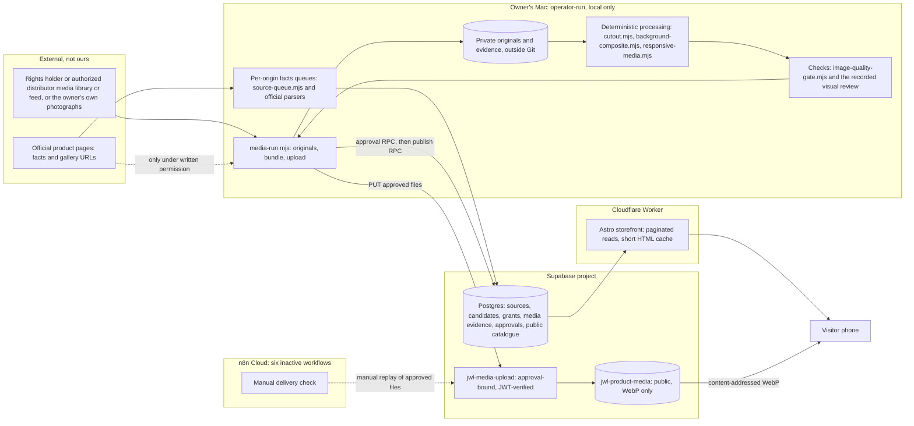
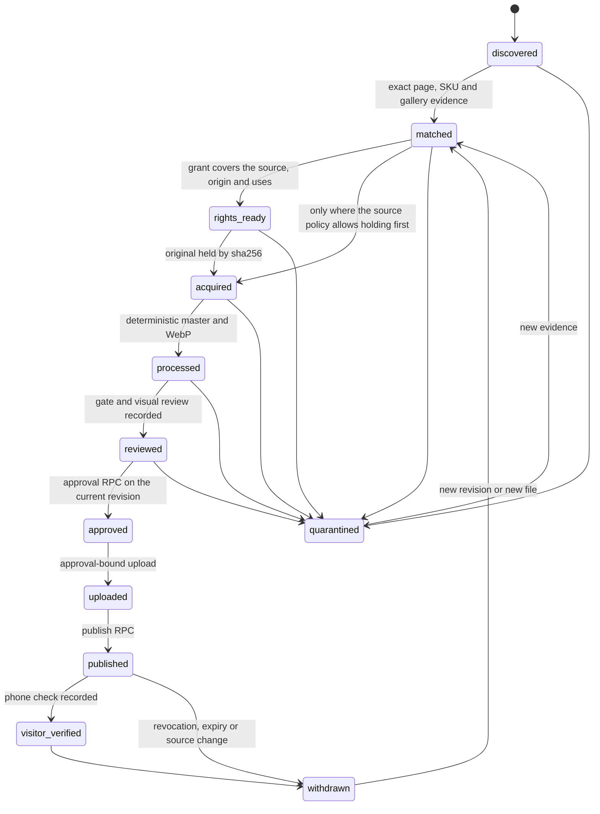

# Bulk original product photos: architecture and rollout

- **Status:** proposed architecture, written by Claude as implementation owner (decision 0010). It is not an owner approval. It authorizes no outreach, spending, production change, source-flag change or publication.
- **Date:** 2026-11-02. Each fact carries its read time and an evidence label from `CLAUDE.md`. The vendor checks are listed in [section 15](#15-vendor-facts-checked-on-2026-11-02).
- **Scope:** the authoritative design for taking genuine product photographs from a rights-cleared source to the public site at catalogue scale.
- **Supersedes:** the media part of the 2026-10-03 target in [`docs/ARCHITECTURE.md`](../ARCHITECTURE.md).
- **Binding rules stay where they are:**
  - the [execution spec](../spec/EXECUTION-SPEC.md) §2–§7;
  - the [models and variants contract](../WEBSITE-MODELS-AND-VARIANTS-CONTRACT.md);
  - [responsive media preparation](../RESPONSIVE-MEDIA-PREPARATION.md);
  - decisions 0011, 0013, 0015 to 0017, and 0019 to 0024.

## 1. What changed publicly

**Nothing.** This is a documentation task. Current counts are observed live from read-only reads on 2026-11-02, the last at 18:53Z:

| Measure | Value |
|---|---|
| Active public variants (one row per catalogue reference) | 4,097 |
| Displayed models | 2,579, of which 395 are grouped. The 2,886 figure is the superseded 2026-10-28 mapping. |
| Models with any photograph | 1. That model has 56 variants, and only 1 of them is photographed. |
| Models with every variant photographed | 0 |
| Variants with their own public photograph | 1 (`m126234-0015`) |
| Files in the public media bucket | 15 objects, 1,612,030 bytes:  • 3 for `m126234-0015`;  • 12 for `m126200-0006`, whose photograph is withdrawn from display. No public row links those 12; they are kept for rollback. |
| Media grants and approvals | 2 and 2, both open-licence. Each covers its exact old file and nothing else. |
| Brand sources with `publication_allowed=true` | 0 of 12 |
| Prepared privately, not publishable | 1 photograph: Longchamp `10166HSR001`, Black. Its 8 derivative files are one product photo, not eight products. |

The pipeline below does not create photo coverage by existing. Coverage arrives only with a rights-cleared source supply ([section 4](#4-source-supply-the-first-dependency)).

## 2. Binding principles

1. **Authentic exact photographs only.**
   - No generation, redrawing, retouching, recolouring or upscaling of a product, and no third-party AI upload.
   - The only alteration allowed is background-only removal with a non-generative mask (decision 0015).
   - Presentation is a flat `#f0f0f0` square or the grey catalogue tile (decisions 0023 and 0024). The local AI background trial is closed.
2. **Rights before publication.** A photo needs one recorded basis: written permission from the rights holder or an authorized distributor, an owner original, or an open licence under decisions 0013 and 0016. A reachable URL, a logo, a supplier relationship or the owner's taste is not a licence (decision 0011).
3. **One card and page per real model.** Sizes are variants of one model (decision 0017). A colour shows only its own photograph (decision 0020).
4. **Free existing stack first:** the Mac, Supabase, n8n and Cloudflare already in use. No new paid model, API, service or subscription.
5. **Honest counting.** A model, a variant, a colour, a photograph and a derivative file are different units ([section 13](#13-counting-and-reporting)).

## 3. Components and roles

| Role | Component | State today |
|---|---|---|
| Media supply | the rights holder, an authorized distributor or the owner | **No supplier has granted rights for any official image.** Permission drafts exist privately and are not sent. |
| Facts discovery | per-origin queues and official parsers on the Mac | exists; operator-run |
| Image compute | the local deterministic processor on the Mac | exists; operator-run; stops when the Mac is off |
| Records and media storage | Supabase: Postgres, the upload function and the public bucket | exists |
| Orchestration and checkpoints | n8n Cloud | the manual delivery check exists. Nothing else is active ([section 9](#9-orchestration-and-the-cloud-and-local-boundary)). |
| Website delivery | the Astro storefront on the existing Cloudflare Worker | exists. Images load from the Supabase bucket's public URLs, not through the Worker. |
| Visual review and package operation | Codex, procedurally independent of the batch writer | exists as a procedure, not a technical control |
| Owner decisions | the owner | listed in [section 4.4](#44-what-runs-now-and-what-waits) |

## 4. Source supply: the first dependency

### 4.1 Source classes

| Class | Rights basis (existing grant kind) | Scale | State, 2026-11-02 |
|---|---|---|---|
| Brand media library or feed | `written_permission` from the rights holder | best: whole collections with colour-specific files | none obtained; no outreach sent |
| Authorized distributor or supplier feed | `written_permission` from an authorized distributor, plus proof that it may sublicense these photographs for this display | good | none. Supplier status alone proves nothing. |
| Owner's own photographs | `owner_original`, one grant per exact product | limited by physical access | none supplied yet |
| Official website images | `written_permission` only | good once permitted | 3 Longchamp packshots held for private evaluation. No permission, so none is publishable. |
| Open licence (Commons) | `open_license` under decisions 0013 and 0016 | poor | historical only. The owner rejected amateur photographs on 2026-11-01, and the bounded search of 2026-11-02 is closed. Not a scale route. |

### 4.2 Five separate facts, never inferred from one another

| Fact | Where it is recorded | What does not prove it |
|---|---|---|
| Access: robots and terms allow the request | `jwl_internal.sources`, robots checks, `recordedSourceStops` in `intake-core.mjs` | the absence of a robots rule |
| Media licence: these photographs may be shown here, processed this way | `jwl_internal.media_grants` plus the private evidence file | a public URL, a credit line, a supplier invoice, the owner accepting responsibility |
| Product identity: this file shows this exact reference and colour | the gallery binding, the private verification record, `media_assets.verified_reference` | a file name, visual resemblance, a model-only reference |
| Visual approval: it meets the owner's standard | the private review record | a passing automated gate |
| Publication: it is live on the site | `publication_approvals`, `jwl_catalog.images`, a visitor check | an upload |

### 4.3 Source-onboarding contract

One record per source, kept as a private evidence file. Its pointer goes in `media_grants.evidence_reference`. A field without evidence is recorded as `missing`; no field has a default.

| Field | Minimal evidence | Stored in | Today |
|---|---|---|---|
| `source_id` | a registered source | `sources.id`, `media_grants.source_id` | exists for the 12 brands |
| `issuer` | the legal name and role of the party granting, and its contact | private evidence | missing for all |
| `issuer_authority` | for a distributor, a document showing its right to sublicense the photographs | private evidence | missing for all |
| `covered_brands` and `media_origins` | the exact hosts, paths or feed identifiers covered | `media_grants.media_origins` (required for `written_permission`) | missing |
| `product_scope` | the whole source, or a list of references | `media_grants.candidate_id` (empty means the whole source), or a list in the evidence | missing |
| `uses` | commercial website display on jwleria.com: listing cards and product pages | `media_grants.website_publication` (must be true) | missing |
| `processing` | resizing, WebP encoding, background-only removal, placement on a flat square | `resize`, `webp_encode`, `background_removal`; square placement is in the evidence text only | missing |
| `redistribution_limits` | for example no sublicensing, no downloads, no social or advertising use | private evidence (social and ads are deferred anyway) | missing |
| `credit` | the required wording and placement, or "none" | private evidence. The storefront renders credits for open-licence images only: gap G3. | missing |
| `territory_and_channels` | where the display may appear | private evidence | missing |
| `term` | start and expiry | `media_grants.expires_at`. An expiring grant is refused until an expiry sweep exists: gap G4. | missing |
| `revocation` | how a takedown arrives and the response time | private evidence; `revoked_at` plus the existing revocation cascade | missing |

### 4.4 What runs now and what waits

| Runs now, with no owner input | Waits for the owner | Waits for the rights holder | Waits for owner approvals |
|---|---|---|---|
|  • Read-only batch manifests from recorded candidates. • Gallery-binding checks. • Processing files already held privately. • Code gaps G1, G5 and G6 with tests. • Package templates. |  • Choosing the first source. • Whether to send the permission request: the Longchamp draft exists privately, recorded in `STATE.md` on 2026-11-01. • Any spending. | Written permission matching the contract above. |  • Setting the source's `publication_allowed`. • Applying reviewed migrations such as gap G2. • A Worker release. |

### 4.5 Proposed first batch and milestone

- **Source:** `longchamp-official`. It is proposed, not approved, and nothing has been sent.
- **Supply shape** (observed live, 2026-11-02):
  - 390 active variants in 136 displayed models;
  - 371 variants whose every recorded gallery URL names the exact reference;
  - 117 models where that holds for every variant.
  - Every gallery URL carries a `.png` hint, which is a format hint only.
  - One held file, `10166HSR001`, has observed native alpha at 2000 × 2000.
- **Milestone:** 100 distinct displayed models, each showing a correct, rights-cleared photograph of an exact variant, and each card showing the variant it links to.
  - It is counted in models, not in files, colours or sizes.
  - It has not been achieved or approved. It depends on Longchamp's written permission.
- **If permission is refused:** owner photographs, an authorized distributor feed or another brand, each through the same stages.

## 5. Acquisition and matching

**Reuse, and add no generic scraper:**

| Module | What it already does |
|---|---|
| `source-queue.mjs` | one paced queue per origin, up to 8 concurrently:  • at least 2 s apart, or the robots or registry delay when longer;  • fresh robots;  • checkpointed resumable state;  • dedup by URL and identity.  Stops:  • 401, 403 or a challenge blocks the origin until a reviewed token;  • 429 waits for the later of `Retry-After` and 15 minutes;  • transient errors retry with capped backoff, and consecutive failures pause the origin. |
| `incremental.mjs`, `jwl_ingest_missing_batch` | missing-only ingestion; changed records go to review, never overwrite |
| `intake-core.mjs` | `recordedSourceStops`: Cartier, Van Cleef & Arpels, CELINE, RIMOWA, Piaget and Panerai stay closed in code |
| `extract-longchamp.mjs`, `extract-official-brands.mjs`, `extract-bags.mjs` | structured page parsing: the SKU in JSON-LD, the exact SKU's own gallery, no script execution |
| `media-pipeline.mjs` |  • `galleryBinding`, `mediaReadiness`, `createMediaPacer`; • `acquireOriginal`, which needs a grant and stops on robots, refusal, redirect or type; • `keepOwnerOriginal`, which makes no network request. |

No proxies, CAPTCHA or authentication bypass, or disguised source hopping. A refused origin stays stopped until a source review.

**Acquisition order follows the source's policy.**
- Official or distributor media is downloaded only after `rights_ready`, which `acquireOriginal` enforces by requiring a grant.
- Owner originals are kept with no request.
- The three Longchamp files held for private evaluation are a recorded exception. They never advance past `processed` without a grant.

**Matching evidence, all required:**
1. The source product page whose structured SKU equals the full catalogue reference, suffix and colour included.
2. The file belongs to that SKU's own gallery.
3. The file URL names the exact reference (`reference_in_asset_url`), or the file is listed in that reference's own gallery and a visual check confirms it.
4. The held bytes hash to the recorded sha256.
5. A recorded visual check of colour and variant.

A model-segment reference never establishes a colour or size suffix. A file name or a resemblance never establishes identity. No confidence percentages are recorded.

**Quarantine reason codes,** recorded with `candidate_id`, `revision_hash`, `source_sha256`, stage, evidence pointer, time and, for a human check, the reviewer:

| Group | Codes |
|---|---|
| Source and rights | `source_refused`, `rights_missing`, `rights_scope_mismatch` |
| Identity | `identity_reference_mismatch`, `identity_suffix_unestablished`, `colour_mismatch`, `size_unestablished`, `gallery_unbound`, `shared_file_conflict` |
| Image quality | `low_resolution`, `not_whole_product`, `clipped_by_source`, `cutout_failed`, `edge_defect`, `generated_or_altered`, `over_budget`, `below_fidelity_floor` |
| Review | `visual_rejected`, `owner_rejected` |
| Duplicates and changes | `duplicate_of`, `changed_after_review` |

## 6. Models, variants and image selection

- **One card and page per genuine model.** Sizes of one design are variants (decision 0017). A different generation, design or material is a separate model unless linking evidence says otherwise (spec M3).
- **Old URLs:** every existing variant URL stays valid, and the canonical URL points to the primary variant (M2).
- **Colours:** each colour needs its own matching photograph. A black image is never shown as, or recoloured into, another colour (spec P1, decision 0020).
- **Size-shared photographs:** one photograph may serve several size variants of one design and colour only when the source says so. That means the same file (same sha256) appears in each size reference's own official gallery, or the rights holder's feed maps it to each reference.
  - Each reference then gets its own evidence and approval rows citing the same original.
  - The model counts one distinct photograph covering N size variants.
  - Without that evidence, a size has no photograph of its own.

**Deterministic image selection on a product page:**
1. The selected variant's own approved photographs, size-shared ones included under the rule above.
2. Otherwise the model's representative photograph, small and apart, captioned with its own reference, size and colour. A colour never substitutes for another colour.
3. Otherwise the explicit state that no approved photograph of this variant exists yet (facts only).

A card always shows the photographed variant it links to.

**Interaction:** these rules come from decisions 0018–0020 and are covered by the tests `variant-labels`, `photo-framing-browser` and the opt-in `variant-browser`. The last rule, that only the selected variant's photographs load, is verified when the first model with several photographed variants exists.
- size first as segments, other options as current-value lists near the image;
- 44 px targets, no hover-only control;
- the image never traps vertical scrolling;
- no jump to an off-screen image;
- only the selected variant's photographs load, never every variant's at once.

**Gap G1: the size-shared rule is blocked in code.**
- **What blocks it:** `background-composite.mjs` version 2 refuses one source file bound to two references (`runJob`: "One source file cannot be bound to two references"). Also, `requireVerification` in `media-pipeline.mjs` has no identity route for "listed in this reference's own official gallery"; its only route for an uncertain pixel read is the creator-stated reference of decision 0013.
- **Proposed safe change** (not implemented): an item may declare `shared_with: [references]`, each with its own gallery evidence for the same sha256. The job accepts it only when:
  - all references share one `model_key`;
  - their `jwl_product_variants.options` differ only in the size kind;
  - each reference's evidence names the same file.
  
  It then processes once and records every covered reference. Anything else is still refused. A matching verification route records the gallery evidence per reference and keeps `exact_reference` honest.
- **Database:** no migration is needed. Evidence and approvals are already per candidate, and derivative paths are per binding, so the bytes are stored once per reference: a few hundred kilobytes, accepted for now.

## 7. Persistence and provenance

| Concept | Existing table, function or file | Status |
|---|---|---|
| Source | `jwl_internal.sources`; `jwl_source_registry()`; `recordedSourceStops` | exists |
| Model | `jwl_product_variants.model_key`, the `jwl_catalog_models` view, `jwl_internal.variant_evidence` | exists |
| Variant | one `public.jwl_catalog` row per reference; `jwl_internal.candidates` and `candidate_revisions` | exists |
| Original asset | the private file named by sha256. `acquireOriginal` records `source_url`, `sha256`, `bytes`, `mime_type`, `acquired_at` and `grant_reference`. `media_assets.original_source` and `original_sha256` record it for each public file. | exists. **Extend (G6):** record dimensions, alpha, `ETag` and `Last-Modified` at acquisition. |
| Binding and evidence | `galleryBinding` over candidate content; `media_assets` (`verified_reference`, `verification_reference`, `grant_reference`, treatment fields, `square_sha256`, `source_clipped`); private verification records | exists |
| Rights grant | `jwl_internal.media_grants` (`owner_original`, `written_permission`, `open_license`) | exists. **Gaps:** expiring grants are unusable (G4); there is no credit for written permission (G3); issuer fields live in private evidence. |
| Treatment and derivative | the manifest (schema 5), with content-addressed paths `v1/<binding digest>/<source sha256>/<width>w-<sha256>.webp`. Database treatments: `background_removal`, `white_square`. | exists. The flat `#f0f0f0` square is local only: gap G2. |
| Visual review | private records (`verification`, `cutout_review`, `square_review`) cited by the approval | exists. Independence is procedural only. |
| Publication projection | `publication_approvals`; `jwl_catalog.images`, `image_variants`, `media_state`; the `jwl_record_media_approval`, `jwl_record_cutout_approval`, `jwl_record_presentation_approval`, `jwl_publish_candidate` and `jwl_publish_factual_batch` functions; the `require_media_evidence` and `require_live_media_grant` triggers | exists |
| Upload | `jwl-media-upload`: JWT-verified. The service credential exists only in the function's own environment. It writes with `upsert: false` and a one-day `cacheControl`. | exists |
| Job or run | `jwl_internal.intake_runs` (facts intake); a local `job-record.json` per processing job | exists for facts. **Proposed (G5):** one private batch ledger file per batch, keyed by idempotency key, with no new table. |
| Rejection or quarantine | none in the database | **Proposed (G5):** private ledger entries using the codes in [section 5](#5-acquisition-and-matching) |
| Revocation | `revoke_media_grant_approvals`, `withdraw_revoked`, `jwl_revoked_media_files()` | exists |

**Rules:**
- **Originals:** private and immutable, named by sha256, never in Git or public rows.
- **Derivatives:** content-addressed and versioned by source sha256, treatment version and encoder settings.
- **Public projection:** only approved minimal data and media.
- **Source URLs:** evidence, never a hotlink for visitors.
- **Credentials:** no service-role credential in browser code, n8n exports or this repository.
- **Existing guards stay enforced:** the approval-bound upload and the current-revision publication guard. An old approval is never reused for a new file. No speculative JWT disable, grant broadening or source-flag change.
- **MCP:** the Supabase MCP connection used by these sessions reaches production. Supabase's guidance is to use it only for development and testing, and with real data to use read-only mode and project scoping ([section 15](#15-vendor-facts-checked-on-2026-11-02)). This project's connection is project-scoped and can write: migrations were applied through it with owner approval. Routine reads should move to a read-only connection, which is an operator configuration (G7).

## 8. Deterministic processing

- **Native transparency** passes through: there is no removal pass (decision 0015).
- **An opaque photograph** gets a non-generative foreground mask (`foreground-mask.swift`, macOS Vision). Then:
  - `cutout.mjs validate` checks it: 8-bit RGBA, upright geometry, opaque pixels within 2 per channel, no canvas-edge contact.
  - a visual review covers edges, straps, holes, metal reflections and shadows.
  - A failed cutout or an opaque leftover is quarantined (`cutout_failed`, `edge_defect`). It is never hidden or re-generated.
- **Flat square** (`background-composite.mjs` version 2):
  - the product's largest extent at 0.68 of a flat `#f0f0f0` square, the whole item, aspect preserved, no crop or stretch;
  - every fully opaque product pixel is verified unchanged in the lossless master before encoding.
  - WebP is lossy, so the pixel-identity claim applies to the master only. Each WebP is measured instead: luma SSIM at least 0.97 against a lossless resize at the same width, within 150,000 bytes up to 960 px and 600,000 bytes for a wider detail file.
  - Widths are 320, 640 and 960 plus a detail of at most 1,600 px. A phone card never downloads the detail file.
- **Resolution floor:** about usable product extent, not empty canvas.
  - The product's largest extent must be at least 653 px, so a 0.68 square reaches the 960 px card file.
  - Display math: a 174 CSS px phone tile at 3× density is 522 device px. A full-width phone detail at 3× is 1,170 device px, where the product fills 0.68, about 796 device px. So a product of 653 to about 795 px is slightly enlarged by the browser in that one view.
  - Smaller products are quarantined (`low_resolution`), never upscaled.
- **Consistent occupancy, gap G2.**
  - **Current:** the live grey tile shows a transparent image in a 70% content box (decision 0023), so apparent size depends on each file's own transparent margin. `10166HSR001` lands at about 66%.
  - **Bytes:** a baked flat square is exact at 0.68 and lighter. For `10166HSR001`, the flat files are 13,254 B at 640 px and 53,092 B at 960 px; the transparent files are 52,764 B and 137,594 B.
  - **Proposed:** a `flat_tile` presentation, bound by its master's sha256 like `white_square` and rendered edge to edge in the tile. It needs:
    - a reviewed migration of `valid_image_variants` and `require_media_evidence`;
    - a storefront change;
    - a Worker release;
    - the owner's approval to apply the migration.
  - Not implemented.
- **Local jobs:** the owner's Mac, an M2 with 8 GB, where swap pressure has been observed.
  - One `10166HSR001` item, both forms, took 26.6 s at a 629 MB peak (observed). A 100-item batch is therefore of the order of an hour (estimate, not measured).
  - Process sequentially in batches of 25 or fewer. Keep at least 10 GiB of disk free.
  - Skip by content hash, and never process a master twice. Outputs are immutable, so a re-run is a no-op.
  - No model downloads.

## 9. Orchestration and the cloud and local boundary

**n8n inventory** (observed live, read-only, 2026-11-02; identifiers stay out of Git):

| Workflow | Trigger | Callable now | Role |
|---|---|---|---|
| Approved image delivery check | manual | yes, by hand | replays already-approved files through `jwl-media-upload`. **It proves delivery idempotency only.** A replay of the old approved files is not evidence of any new batch. |
| Durable catalog intake | daily schedule, inactive | no | missing-only facts intake. Its database nodes are disabled until the owner approves a least-privilege runner credential and activation, after the recorded runner defects are fixed. |
| Origin intake run | sub-workflow of the above | no | one origin per run, with a lock, robots and a reviewed sitemap |
| Catalog candidate normalization | manual helper | yes, as a helper | facts normalization, with no database writes |
| Social draft preparation | — | out of scope | deferred |
| jWleria Google Shopping (2026-08) | — | out of scope | legacy, unrelated |

**Facts that fix the boundary** ([section 15](#15-vendor-facts-checked-on-2026-11-02)):
- The n8n Cloud Code node cannot import external npm modules (only `crypto` and `moment`), and it cannot use the file system or make HTTP requests itself.
- The Execute Command node is not available on n8n Cloud.
- So `sharp`, Vision and the local files cannot run there. n8n Cloud cannot reach this Mac's localhost, and no tunnel exists.
- When the Mac is off, processing stops; nothing continues in the cloud.

**Phase 1, the only phase authorized to run, operator-assisted:**

| Step | Trigger and actor | Input | Output | State |
|---|---|---|---|---|
| 1. Batch manifest | the operator runs a read-only query on the Mac | the source's recorded candidates | a private manifest of models, variants, colours, sizes and binding status | callable |
| 2. Originals | `node media-run.mjs originals PRIVATE.json` | the manifest and a live grant | private originals by sha256, with acquisition records | callable once a grant exists |
| 3. Processing | `node background-composite.mjs PRIVATE_JOB.json`; `cutout.mjs` only where needed | the originals | masters, WebP files and job records | callable |
| 4. Gate and review | `node image-quality-gate.mjs`, then Codex's visual review | the outputs | gate reports and review records | callable |
| 5. Bundle and approval | `node media-run.mjs bundle PRIVATE.json`, then the approval RPC | the reviews and the grant | an approval bound to the current revision | callable; a production write needs its normal approval |
| 6. Upload | `node media-run.mjs upload PRIVATE.json` (token from the environment) | the approved files | stored objects, or `already_present` | callable |
| 7. Publish | `node supabase.mjs publish PRIVATE_REVIEW.json` | the approval | public rows with images | callable; a production write |
| 8. Delivery replay (optional) | the manual n8n check | the approved file list | a 200 or 201 per file | callable; proves delivery only |

**Integration gap and later options.** None is chosen; each needs its own decision, scoped credentials and authority:
1. **Pull-based:** the Mac pulls a queue with an outbound-only scoped credential. No inbound endpoint is needed. This is the preferred later option.
2. **Self-hosted n8n on the Mac:** Execute Command would be available, but it is a new local service.
3. **A cloud image worker:** a new service and a new cost.

Not now: no tunnel, endpoint, daemon, cron, new credential or role, or activated workflow.

## 10. Lifecycle and resilience

| Stage | Entry evidence | Idempotency key | Failure and recovery |
|---|---|---|---|
| discovered → matched | candidate revision, page SKU, gallery binding | `candidate_id` + `revision_hash` | a changed revision goes back to review |
| rights_ready | a live, unexpired, unrevoked grant covering the origin | `grant_reference` | missing or narrower scope: `rights_missing` |
| acquired | acquisition record, sha256 | `source_sha256` | a refusal stops the origin; no retry through a refusal |
| processed | job record, 0 changed opaque pixels | `source_sha256` + treatment kind and version + parameters + encoder | rerun is a no-op; a defect quarantines |
| reviewed | gate report, visual review by someone other than the batch writer | the review names the exact master and derivative sha256 | never written by code to pass a test |
| approved | the approval RPC accepts | `candidate_id` + `revision_hash` + exact file set | the database refuses mismatches |
| uploaded | `uploaded` or `already_present` per file | the content-addressed path | a partial batch resumes per file |
| published | the publish RPC on the current revision | `candidate_id` + `revision_hash` | per product; others continue |
| visitor_verified | a recorded phone check | product and release | a failure reverts that product to facts only |

**Withdrawal** after revocation, expiry or a source change:
- Revoking a grant withdraws its products at once through the existing cascade. A new revision also withdraws.
- Public files are deleted only under the existing takedown process (spec P7), never as unrequested cleanup.
- Originals and evidence are kept.
- Caches drain within:
  - the Worker's stale window of under 600 s (spec K4);
  - Supabase's CDN invalidation of up to 60 s, where Smart CDN applies;
  - one day in browsers.
- A size or colour correction needs a new approval for the new file; an old approval bound to another asset is never reused.

## 11. Fast mobile delivery

**Exists:**
- **Pagination:** catalogue reads are paginated on the server (PostgREST `limit` and `offset`; 12 per page by default, 48 at most), so no visitor payload carries thousands of rows. Brand pages and product pages read only their own model data.
- **HTML caching:** anonymous approved HTML is cached for 60 s fresh, then served stale for under 600 s, keyed by release. Workers Cache API contents stay in the data center that wrote them.
- **Image files:** derivatives are immutable and content-addressed, with a one-day browser lifetime.
- **Card markup:** a srcset of 320, 640 and 960 px, `sizes` matched to the compact tile (`product-media.mjs`), and declared width and height so the height is stable.
- **Loading:** only a likely LCP card is eager with `fetchpriority`; the rest are lazy. A card never loads a detail file.
- **No heavy libraries:** no 3D or heavy gallery library is used.

**Targets.** These are proposed targets, not measured results:
- at the 75th percentile of mobile page loads: LCP ≤ 2.5 s, INP ≤ 200 ms, CLS ≤ 0.1;
- on product and catalogue pages: CLS 0 (spec F1);
- per card image: ≤ 150,000 bytes.

**Remaining checks:**
- a physical iPhone and a 3× pixel ratio;
- field data: none is collected, so percentile claims cannot be made today (spec F4);
- live cache `HIT` and `STALE` labels (maintenance backlog).

**Cost:** no hosting upgrade is proposed without a measured bottleneck. Current subscriptions are not audited here. The free processing path adds no marginal service cost. Licensed media supply may cost money, and that cost is unknown.

## 12. Rollout stages

| # | Stage | Input dependency | Actor | Done when | Rollback |
|---|---|---|---|---|---|
| 0 | Inventory and source clearance | recorded candidates | Claude, read-only | a private manifest for the chosen source reconciles with the live counts | none needed (read-only) |
| 1 | Rights | the owner sends the request; the rights holder answers; the owner decides the source flag | owner, then the operator records the grant |  • the grant row is live; • its evidence file matches the contract; • the flag is set by the owner. | revoke the grant (cascade); reset the flag |
| 2 | Exact allowed acquisition | stage 1 | operator runs `media-run.mjs originals` | every manifest item is held or has a recorded refusal | none needed (private files); an origin stop is respected |
| 3 | Treatment sample, once | stage 2 | Claude processes; Codex and the owner review | one accepted treatment configuration is recorded from about 10 items across shapes | discard private outputs |
| 4 | Batch of 100 distinct models | stage 3 | Claude prepares; Codex reviews; the operator records approvals | 100 distinct models have approved exact-variant photographs, each within budget and floor | revoke approvals (nothing is visible yet) |
| 5 | Controlled publish | stage 4 | operator, in sub-batches of 25 | the public rows show the images; partial success is allowed | republish facts only for an affected product |
| 6 | Visitor check | stage 5 | Codex | Arabic and English at 390 × 844 and at desktop width are recorded; a physical iPhone when available | as stage 5 |
| 7 | Expand | a new source cleared | all | each further source repeats stages 1–6, concurrently but within per-origin limits | per source |

The sample validates the treatment once; it is not a new project phase. No completion percentage and no time to full coverage is claimed.

## 13. Counting and reporting

| Metric | Definition | Value, 2026-11-02 |
|---|---|---|
| Public models | displayed models | 2,579 |
| Public variants | active catalogue references | 4,097 |
| Models with any photograph | at least one variant has its own photograph | 1 |
| Models with every variant photographed | full-variant coverage | 0 |
| Distinct photographed variants | variants with their own photograph; a size-shared photograph counts once per variant it covers and once as a photograph | 1 |
| Distinct public photographs | unique source originals shown publicly | 1 |
| Source originals held privately | by sha256 |  • 3 official Longchamp (1 bound to the catalogue); • Commons: 7 renditions and 1 original; • 4 rejected candidates kept as evidence. |
| Rejected or quarantined | product files, by reason |  • 4 Commons candidates, rejected on 2026-11-02; • 1 owner-rejected photograph (`m126200-0006`). |
| Derivative files | WebP objects | 15 public (1,612,030 B); 8 private for `10166HSR001`, which are 1 photograph |
| Published images | photographs linked by a public row | 1 |
| Visitor-verified images | recorded phone checks | 1 (`m126234-0015`) |

Never count the sizes of one WebP, or a size-shared photograph, as several products.

**Every report answers, in order:**
1. what changed publicly, with zero stated if zero;
2. the counts above, with their denominators;
3. actual failures;
4. the one external dependency.

## 14. Gaps and the next implementation scope

| Gap | Exact place | Proposed change | Needs |
|---|---|---|---|
| G1 size-shared photographs | `background-composite.mjs` `runJob`; `media-pipeline.mjs` `requireVerification` | `shared_with` with per-reference gallery evidence, accepted only when the variants differ in size alone | code and tests; no migration |
| G2 exact occupancy in the tile | `valid_image_variants`, `require_media_evidence`; the storefront tile | a `flat_tile` presentation bound by its master's sha256, drawn edge to edge | a reviewed migration, a Worker release, and the owner's approval to apply it |
| G3 credit for written permission | the credit rendering in `ProductGallery.astro` (open-licence only) | render a licence-required credit for `written_permission` grants | only if a licence requires a credit |
| G4 expiring grants | `require_live_media_grant` refuses `expires_at` | a reviewed expiry sweep, with `pg_cron` available but not installed | a reviewed migration and approval |
| G5 batch ledger and quarantine | local files only | a private ledger schema keyed by the idempotency keys in [section 10](#10-lifecycle-and-resilience) | code with stage 0 |
| G6 acquisition record | `acquireOriginal` | add dimensions, alpha, `ETag` and `Last-Modified`; conditional re-checks | code and tests |
| G7 MCP access | the operator's MCP configuration | a read-only, project-scoped connection for routine reads | operator configuration |
| G8 cloud orchestration | — | the pull-based option in [section 9](#9-orchestration-and-the-cloud-and-local-boundary), only when chosen | a separate decision |

## 15. Vendor facts checked on 2026-11-02

| Claim used above | Official source |
|---|---|
| Smart CDN is on for the Pro plan and above. An updated or deleted asset is invalidated in up to 60 s. The browser lifetime follows `cacheControl`. A changed asset should go to a new path. This project's plan was not read, so whether Smart CDN applies is unknown. | <https://supabase.com/docs/guides/storage/cdn/smart-cdn> |
| The Supabase MCP server is designed for development and testing. With real data, use `read_only=true` and project scoping, and approve tool calls manually. | <https://supabase.com/docs/guides/ai-tools/mcp> |
| Supabase MCP is a public alpha; Storage CDN and Smart CDN are generally available. | <https://supabase.com/docs/guides/getting-started/features> |
| The n8n Cloud Code node cannot import external npm modules (only `crypto` and `moment`), and the Code node cannot use the file system or make HTTP requests itself. | <https://docs.n8n.io/code/code-node/> |
| The n8n Execute Command node is not available on n8n Cloud. | <https://docs.n8n.io/integrations/builtin/core-nodes/n8n-nodes-base.executecommand/> |
| Workers Cache API contents do not replicate outside the originating data center. | <https://developers.cloudflare.com/workers/runtime-apis/cache/> |

No package, plan, database or source flag was changed because of these checks.
